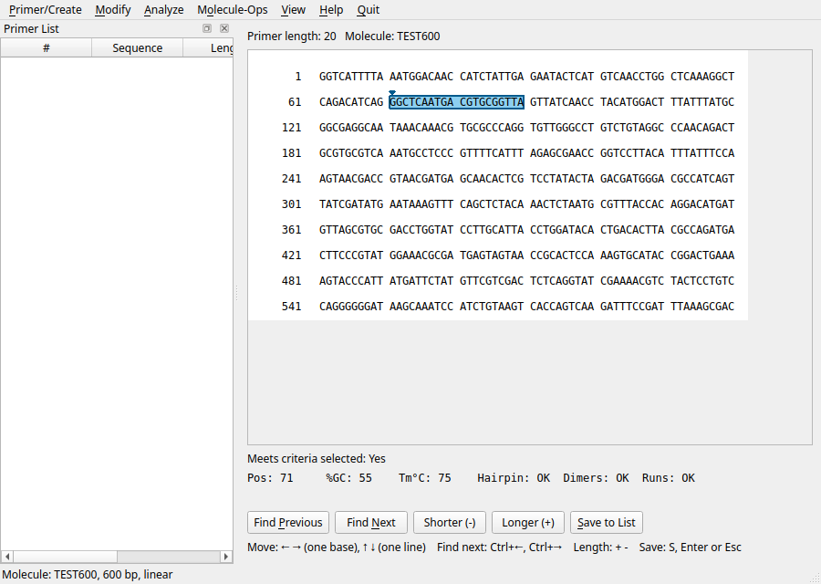
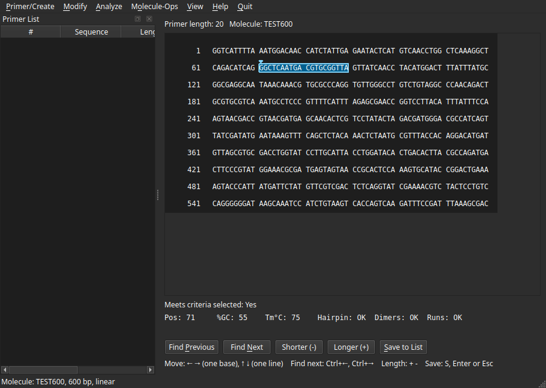
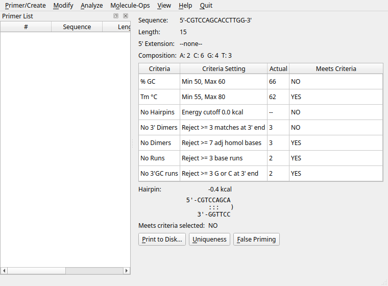
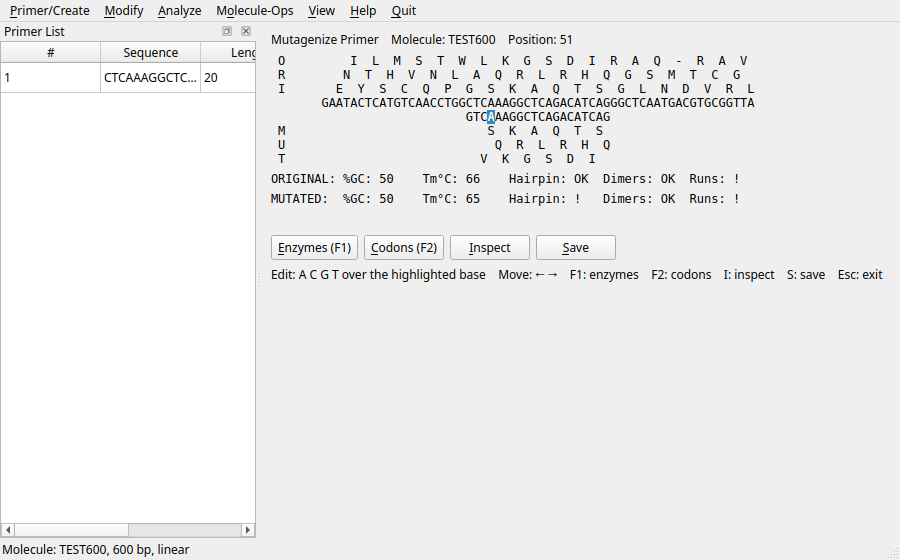

# primerpicker

interactive design of PCR primers

(primerpicker is developed with the help of Anthropic's Claude Opus
5.5)

primerpicker designs and checks PCR and sequencing primers. It is
inspired by *Primer Designer* v2.0 (Scientific & Educational Software,
1990-1991), a graphical tool for DOS that some laboratories still run in
an emulator. Version 1 reproduces its features, default values and
results; later versions will add modern methods.

- implemented in modern C++ (C++20), with a core library that has no
  user interface and is unit-tested;
- aiming for high-quality programming standards: test-driven
  development, warning-free builds with GCC and clang, sanitizers,
  static analysis (clang-tidy, cppcheck), fuzzing of every reader of
  untrusted input;
- a graphical user interface *and* a command-line interface (the
  graphical interface, in Qt 6, is under development; the
  command-line interface is usable now);
- runs on Windows, macOS and GNU/Linux.

Every result is checked against reference values: screens recorded
from Primer Designer itself (`tests/legacy/`, with the tools that
recorded them), published tables, and reference implementations
(Primer3, REBASE).


## What it can do

Command-line interface (`primerpicker --help`):

- **`analyze`**: one primer, with an optional 5' extension: length,
  base composition, GC %, melting temperature, hairpins, self-dimers
  (matches at the 3' end, adjacent homologous bases), runs of bases
  and of G/C at the 3' end, each checked against the criteria;
- **`pair`**: two primers: balance (length, GC % and Tm differences),
  cautions, and the A:A, B:B and A:B dimers;
- **`multi`**: two to four primers: balance, cautions, and the dimer
  matrices of the Multi Primer Analysis;
- **`find-pair`**: pairs of primers around two targets of a molecule,
  ranked with five weighting factors (GC and Tm mismatch, 3' dimers,
  any dimers, false priming), with chosen search windows;
- **`find-enzymes`**: restriction sites on both strands of a linear or
  circular molecule, exact or with one mismatch, for the commercially
  available enzymes of REBASE (old enzyme names are accepted);
- **`--config`**: the criteria, tolerances, search windows and weights
  of a Primer Designer settings file (`pd2.cfg`).

Graphical interface (`primerpicker-gui`, under development): the menu
bar of Primer Designer (items not available yet are greyed out),
Direct Entry, From Molecule (GenBank, FASTA or plain-sequence files),
Retrieve from disk (`.PD2`), the 5' extension, a Primer List; the
Primer Analysis of the active primer (with its hairpin, Uniqueness,
False Priming and the One Primer report), Primer Pair, Multi Primer,
Match Active Primer, Find Pair and Find Enzymes; `--config` for a
`pd2.cfg` file, and a System / Light / Dark colour scheme.
Since then: the picking screen (move the primer along the molecule,
change its length, find the next primer that meets the criteria),
Modify -> Position, Length and Mutagenize, Molecule-Ops -> View/Edit
and Save/Remove, and the molecule files Primer Designer writes.


## Screenshots

The picking screen of From Molecule (light and dark colour schemes):





The Primer Analysis of the active primer, and the Mutagenize screen:





The screenshots are made by hidden GUI tests, for instance
`PRIMERPICKER_SCREENSHOT_DIR=DIR build/debug/tests/gui/gui_tests
'[.picking_screenshots]'` (also `[.screenshots]` and
`[.mutagenize_screenshots]`).

Also in the core library, for the graphical interface: Match Active
Primer (a partner for a given primer), uniqueness and false priming
on the template, PCR product Tm and annealing temperature, and the
molecule (GenBank, FASTA, plain sequence) and primer (`.PD2`) files
of Primer Designer.


## Molecule size

primerpicker has no fixed limit on the length of a molecule (Primer
Designer refused a sequence text of 64 KB or more: about 51,000 bases
in a GenBank file, `tests/legacy/README.md`). Positions are
`std::size_t` throughout (64-bit on the supported platforms); the
largest molecule tested has 4.3 billion bases,
more than 2^32 (`tests/large/`, an opt-in test). In practice the limit
is memory and time. Measured on an Intel Core Ultra 9 285 (release
build, one thread):

| Molecule | Reading + `find-enzymes` | Memory | `find-pair` | `find-pair`, 99 + 99 primers |
|---|---|---|---|---|
| 1 million bases | 0.01 s | 8 MB | 3 s | 28 s |
| 10 million bases | 0.14 s | 40 MB | 29 s | 279 s |
| 100 million bases | 1.3 s | 330 MB | 217 s | (not measured) |
| 4.3 billion bases | 54 s | 12.7 GB | (not measured) | (not measured) |

Memory is about 3 bytes per base while a molecule is read. `find-pair`
searches the whole molecule for false-priming sites of each possible
primer: its time grows with the molecule and with the number of
possible primers (random molecules, targets 300 and 900, built-in
criteria; last column: relaxed criteria, so that 99 primers qualify
on each side, the most a search accepts).


## Example

```console
$ primerpicker analyze GTAAAACGACGGCCAGT
Sequence:      5'-GTAAAACGACGGCCAGT-3'
Length:        17
5' extension:  --none--
Composition:   A:6  C:4  G:5  T:2

Criteria         Setting                                  Actual  Meets
% GC             min 50, max 60                               52  YES
Tm °C            min 55, max 80                               64  YES
No hairpins      energy cutoff 0.0 kcal                       --  YES
No 3' dimers     reject >= 3 matches at 3' end                 2  YES
No dimers        reject >= 7 adjacent homologous bases         4  YES
No runs          reject >= 3 base runs                         4  NO
No 3' GC runs    reject >= 3 G or C at 3' end                  0  YES

Hairpin:       no hairpins found
Meets criteria: NO
```


## Building

Requirements: CMake 3.28 or later, Ninja, and a C++20 compiler (GCC 13
or later, clang 18 or later, or Apple clang). Catch2 3 is used when it
is installed, and downloaded otherwise. The graphical interface needs
Qt 6.8 or later (Widgets; and Test for its tests; on Debian and
Ubuntu: `qt6-base-dev`): it is built when Qt is found
(`-DPRIMERPICKER_GUI=AUTO`, the default; `ON` requires it, `OFF` skips
it).

```sh
cmake --preset release
cmake --build --preset release
ctest --preset release
```

The `release` preset builds with GCC; the programs are
`build/release/src/cli/primerpicker` and
`build/release/src/gui/primerpicker-gui`. Other presets
(`CMakePresets.json`) build with sanitizers (`debug`), with clang and
libc++ (`clang-debug`), for Windows with MinGW-w64 (`mingw-release`),
and the fuzzing harnesses (`fuzz`).

Pre-compiled executables are attached to the releases (the version
number replaces `X.Y.Z`):

| System | Graphical program | Command-line program |
|---|---|---|
| Windows 11 (x86_64) | `primerpicker-gui-X.Y.Z-windows-x86_64.zip`: unpack, run `primerpicker-gui.exe` | `primerpicker-X.Y.Z-windows-x86_64.zip` |
| macOS 14.4 or later (Apple silicon and Intel) | `primerpicker-gui-X.Y.Z-macos-universal.dmg`: open, drag PrimerPicker to Applications | `primerpicker-X.Y.Z-macos-universal.tar.gz` (macOS 13.3 or later) |
| GNU/Linux x86_64 (glibc 2.39 or later: Ubuntu 24.04, Debian 13, or newer) | `primerpicker-gui-X.Y.Z-linux-x86_64.AppImage`: make it executable (`chmod +x`), run it | `primerpicker-X.Y.Z-linux-x86_64.tar.gz` (also `aarch64`) |

`SHA256SUMS` lists the checksums of the files. The programs are not
signed by a known developer: on Windows, SmartScreen asks for
confirmation ("More info", "Run anyway"); on macOS, the first launch
is refused, then allowed in System Settings, Privacy & Security,
"Open Anyway". The AppImage needs FUSE to start (present on desktop
systems; otherwise run it with `--appimage-extract-and-run`).


## Related tools

Other free tools for designing or checking primers, with other methods
and more modern thermodynamic models:

- [Primer3](https://github.com/primer3-org/primer3): the reference
  open-source primer design library and command-line tools (`primer3_core`,
  `oligotm`, `ntthal`); also available in Python as
  [primer3-py](https://pypi.org/project/primer3-py/). primerpicker's
  tests use Primer3 as a reference implementation.
- [Primer3Plus](https://www.primer3plus.com/): a web interface to
  Primer3.
- [Primer-BLAST](https://www.ncbi.nlm.nih.gov/tools/primer-blast/)
  (NCBI): primer design with a specificity check against sequence
  databases.
- [PerlPrimer](https://perlprimer.sourceforge.net/): a desktop
  graphical program for PCR, bisulphite and real-time PCR primers (no
  longer developed).
- [MFEprimer](https://www.mfeprimer.com/)
  ([source](https://github.com/quwubin/MFEprimer-3.0)): specificity,
  dimers and hairpins of primer sets, on a web server or the command
  line.
- [OligoAnalyzer](https://www.idtdna.com/calc/analyzer) (IDT, free web
  tool, proprietary): Tm, hairpins and dimers with salt corrections.
- [REBASE](http://rebase.neb.com/rebase/rebase.html) and
  [NEBcutter](https://nc3.neb.com/NEBcutter/) (New England Biolabs):
  restriction enzymes and their sites.

## Citation

See `CITATION.cff` (GitHub shows it as "Cite this repository").


## License

primerpicker is free software, released under the GNU General Public
License, version 3 or later (`LICENSE`).

primerpicker is not affiliated with Scientific & Educational Software;
Primer Designer is their product, and is not part of this repository.

The restriction enzyme data come from REBASE (version 610, files in
`data/rebase/`): Roberts RJ, Vincze T, Posfai J, Macelis D (2010)
REBASE - a database for DNA restriction and modification: enzymes,
genes and genomes. *Nucleic Acids Research* 38: D234-D236.
[doi:10.1093/nar/gkp874](https://doi.org/10.1093/nar/gkp874)
